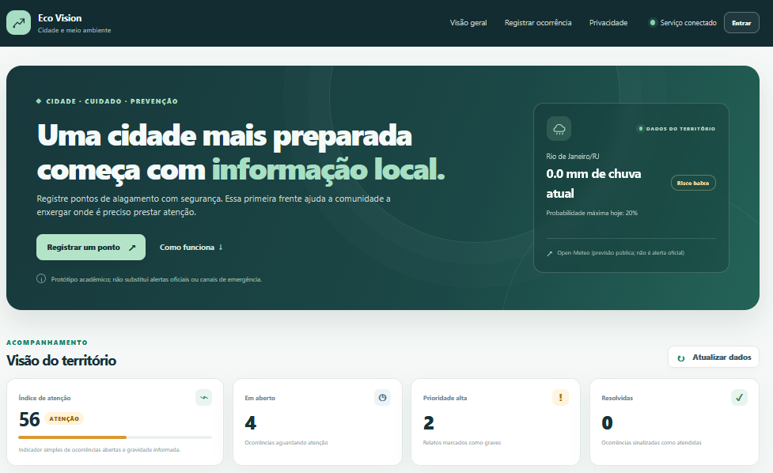
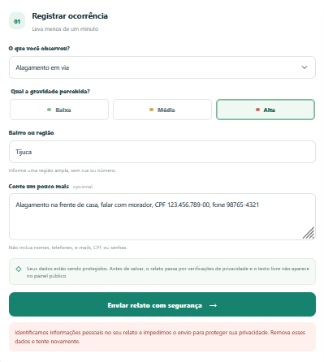
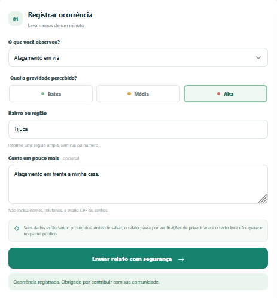
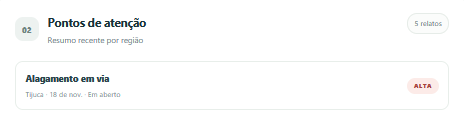
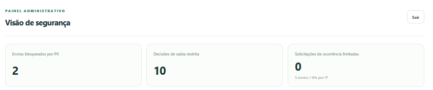
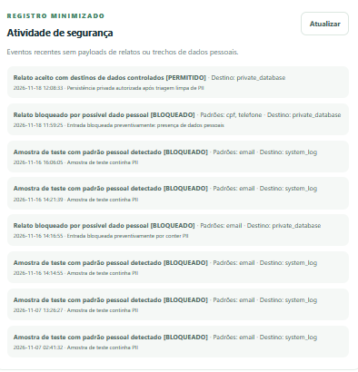
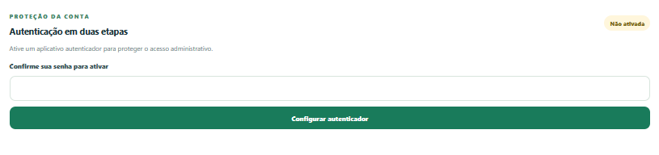
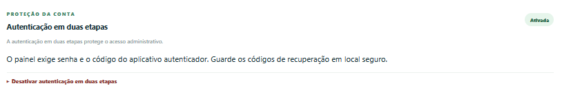
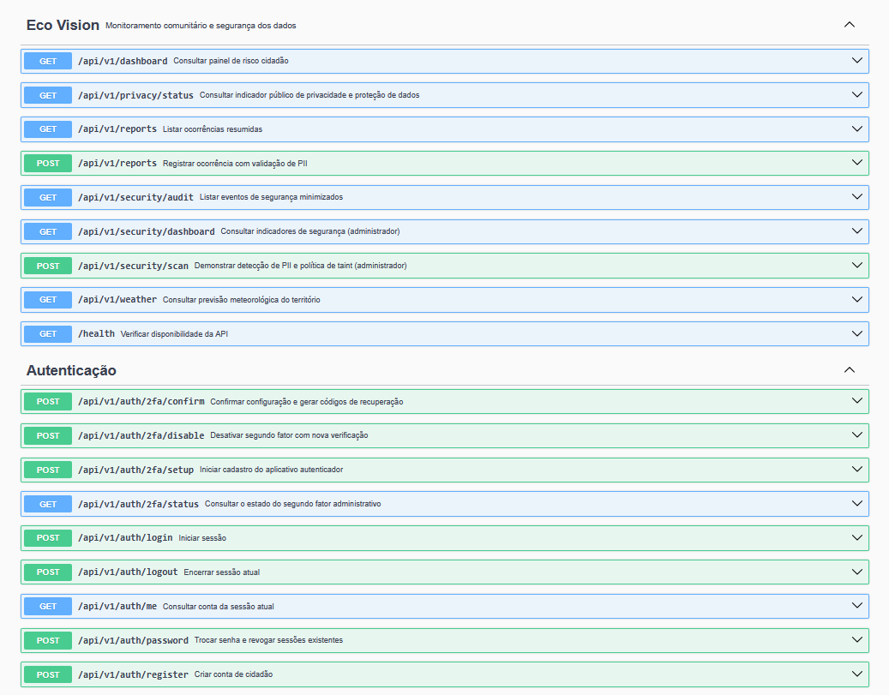

# Eco Vision — CitizenTech para Desafios Urbanos

[](https://www.rust-lang.org/)
[](https://github.com/tokio-rs/axum)
[](https://sqlite.org/)
[](http://127.0.0.1:8080/docs)

O **Eco Vision** é um protótipo acadêmico *CitizenTech* desenvolvido em Rust, projetado para registrar ocorrências urbanas (como pontos de alagamento e vias obstruídas), calcular indicadores explicáveis de risco territorial e proteger integralmente as informações pessoais dos cidadãos.

---

## 1. Contexto e Proposta CitizenTech

- **Desafio Urbano:** Ausência de canais comunitários acessíveis e estruturados para mapeamento colaborativo de alagamentos e impactos pluviais nas cidades.
- **Público Beneficiado:** Moradores, pedestres e comerciantes de áreas sujeitas a alagamento; associações comunitárias e equipes municipais de zeladoria/defesa civil.
- **Privacidade por Design (Privacy by Design):** Ao registrar uma ocorrência, o cidadão precisa fornecer apenas bairro geral e gravidade percebida. O texto livre submetido passa por um rigoroso pipeline de **Parsing de PII** e **Taint Analysis** antes de qualquer gravação ou disseminação. O painel comunitário é estritamente agregador e nunca expõe textos brutos de relatos.
- **Visão de Futuro:** Expandir a plataforma para outros eixos urbanos e ambientais: descarte irregular de resíduos sólidos, monitoramento de ilhas de calor, áreas verdes, saneamento e acessibilidade urbana.

### ODS Relacionados
- **ODS 11 — Cidades e Comunidades Sustentáveis:** Mapeamento descentralizado para reduzir barreiras de mobilidade e planejar infraestruturas resilientes.
- **ODS 13 — Ação Contra a Mudança Global do Clima:** Informação comunitária e leitura meteorológica pública (Open-Meteo) para mitigação de impactos de chuvas torrenciais.
- **ODS 3 — Saúde e Bem-Estar:** Apoio indireto à prevenção de acidentes e redução de exposição a águas contaminadas por alagamento.

---

## 2. Arquitetura da Solução e Fluxo de Dados

O projeto adota princípios de **Clean Architecture** e **Arquitetura em Camadas (Layered/Hexagonal)**, garantindo separação rígida entre regras de domínio, contratos, persistência e camada HTTP:

```text
src/
├── application/
│   └── eco_vision_service.rs      # Coordenação de casos de uso e orquestração de segurança
├── contracts/
│   └── api_contracts.rs           # Contratos DTO, esquemas OpenAPI e respostas estruturadas
├── domain/
│   ├── pii_detector.rs            # Parsing sintático/estrutural de PII e análise recursiva de JSON
│   ├── risk_scoring.rs            # Cálculo explicável de índice de atenção territorial
│   └── mod.rs
├── infrastructure/
│   ├── app_configuration.rs       # Parsing seguro de variáveis de ambiente (.env)
│   ├── database_repository.rs     # Persistência SQLite parametrizada, migrações e auditoria
│   ├── llm_alert_translator.rs    # Tradução defensiva de alertas por IA (Zero Data Leakage)
│   └── weather_provider.rs        # Cliente HTTP para leitura meteorológica pública (Open-Meteo)
├── presentation/
│   └── http_api.rs                # Rotas Axum, middlewares de segurança e Swagger UI
├── security/
│   ├── taint_policy.rs            # Máquina de estados de Taint Analysis e controle estrito de Sinks
│   ├── passwords.rs               # Hashing de senhas com Argon2id e salt criptográfico
│   ├── rate_limiter.rs            # Rate limiting em memória por IP (Token/Sliding window)
│   └── two_factor.rs              # TOTP RFC 6238 e criptografia autenticada ChaCha20-Poly1305
migrations/                        # Migrações versionadas (0001 a 0004)
frontend/                          # Interfaces desacopladas (HTML5 semântico, CSS3 e Vanilla JS)
tests/                             # Suíte de testes unitários e de integração de API
```

### Fluxo de Dados Seguro (Sink Control)
```
[ Cidadão / Formulário ]
          │ (Payload HTTP)
          ▼
[ Rate Limiter em Memória ] ──(Excedeu)──► HTTP 429 + Retry-After + Audit
          │ (Válido)
          ▼
[ Taint Analysis: TaintedText ]
          │
          ▼
[ Detector PII & JSON Scanner ]
   ├── (PII Detectada) ──► Bloqueia gravação
   │                       │
   │                       ├──► Auditoria Estruturada (sink: private_database, decision: blocked)
   │                       └──► Tradutor IA (recebe APENAS código "PII_DETECTED") ──► Retorna HTTP 422
   │
   └── (Texto Limpo) ──► Autorizado para PrivateDatabase
                         │
                         ├──► Inserção no SQLite (Prepared Statement)
                         ├──► Auditoria Estruturada (sink: private_database, decision: allowed)
                         └──► PublicDashboard (RECEBE APENAS AGREGADOS / SEM TEXTO LIVRE)
```

---

## 3. Cybersecurity

### 3.1 Parsing de PII e Categorias Suportadas (`src/domain/pii_detector.rs`)
O motor de detecção analisa entradas textuais e estruturas completas de dados, sem armazenar nem vazar os valores identificados:
- **CPF Sintático e Algorítmico:** Identifica padrões sintáticos clássicos como `"123.456.789-00"` (mesmo com dígitos verificadores matematicamente inválidos, garantindo proteção contra vazamentos acidentais em campos de texto) e valida CPFs matematicamente pelo algoritmo de módulo 11.
- **RG Brasileiro:** Padrões estaduais flexíveis (ex.: `12.345.678-9`, `12.345.678-X`, `1.234.567-8`) e números antecedidos por termos de identificação civil.
- **E-mails e Telefones:** Padrões RFC de e-mail e formatos brasileiros de telefone fixo e celular com ou sem DDD/código do país.
- **Endereços e CEP:** Expressões para logradouros, números residenciais e CEPs (`00000-000`).
- **Credenciais e Segredos:** Detecção de padrões de chaves e senhas (`senha:`, `password=`, `secret:`, etc.).
- **Tokens e Chaves de API:** Identificação de tokens Bearer, prefixos comuns de mercado (`api_key`, `ghp_`, tokens JWT estruturados `ey...`).
- **Dados de Saúde e CID:** Termos médicos explícitos, diagnósticos, laudos, receitas e padrões de Classificação Internacional de Doenças (ex.: `CID A00`, `CID-10 J11`).
- **Varredura Recursiva de JSON (`scan_json_pii`):** Percorre objetos e arrays aninhados em qualquer profundidade, inspecionando simultaneamente o nome das chaves (ex.: `"documento"`, `"cpf"`, `"usuario"`) e o valor de cada propriedade.
- **Mascaramento Seguro (`mask_identifier`):** Função determinística para mascarar dados sensíveis (ex.: `123.***.***-00` ou `us***@domain.com`).

### 3.2 Taint Analysis e Controle de Sinks (`src/security/taint_policy.rs`)
Implementação de análise de mancha em tempo de compilação e execução através do tipo encapsulado `TaintedText`:
- **6 Sinks Mapeados:**
  1. `PrivateDatabase`: Armazenamento interno no banco SQLite. Exige que o texto passe no scanner de PII (`scan_pii_passed == true`).
  2. `PublicDashboard`: Painel comunitário aberto. **Sempre bloqueado** para texto livre de usuários; recebe exclusivamente contadores e métricas agregadas.
  3. `ExternalWeatherApi`: Chamadas para a API externa de meteorologia. **Sempre bloqueado** para entrada de usuários (apenas coordenadas da cidade são enviadas).
  4. `LlmProvider`: Provedor externo de Inteligência Artificial. **Sempre bloqueado** para qualquer texto ou relato submetido.
  5. `SystemLog`: Mecanismos de tracing e logs da aplicação. **Sempre bloqueado** para dados de usuários brutos (registram-se apenas identificadores técnicos).
  6. `HttpResponse`: Respostas entregues ao cidadão. **Sempre bloqueado** para eco de PII ou categorias detalhadas que possam alimentar ataques de adivinhação.

### 3.3 Integração Segura com IA / LLM (`src/infrastructure/llm_alert_translator.rs`)
- **Princípio de Zero Data Leakage:** A LLM **jamais recebe dados do usuário, relatos livres ou informações de contexto sensível**.
- **Comunicação por Códigos Padronizados:** O backend envia exclusivamente enums técnicos mapeados (`SecurityEventCode`):
  - `PII_DETECTED`: Tentativa de submissão com dados pessoais identificados.
  - `TAINT_SINK_BLOCKED`: Bloqueio por política de destino não autorizado.
  - `UNSAFE_LOG_BLOCKED`: Tentativa de registrar dado não confiável em log.
  - `HTTP_OUTPUT_BLOCKED`: Violação de saída HTTP para o cidadão.
  - `UNAUTHORIZED_SECURITY_ACCESS`: Tentativa de acesso sem papel administrativo.
  - `RATE_LIMIT_TRIGGERED`: Excedido o limite de requisições por janela.
  - `SECURITY_VALIDATION_FAILED`: Falha genérica de integridade de segurança.
  - `NO_KNOWN_PII`: Amostra de teste verificada sem detecções.
- **Robustez e Defesa em Profundidade:**
  - Timeout rígido de 4 segundos nas requisições HTTP para a LLM.
  - Limite máximo de resposta de 120 tokens.
  - Prompt de sistema defensivo instruindo respostas em pt-BR claras, educativas e amigáveis.
  - Fallback local determinístico em caso de falha de conexão, timeout ou ausência de chave de API configurada.

### 3.4 Painel de Segurança e Privacidade com Estados Visuais
Na interface do cidadão (`frontend/Index.html` e `Dashboard.js`), possui a seção **"Segurança e Privacidade"** conectada ao endpoint `/api/v1/privacy/status` e `/api/v1/dashboard`:
- **Estados Visuais Determinísticos:**
  - **Verde (Operação normal / Proteções ativas):** Nenhum incidente recente; todas as proteções em funcionamento.
  - **Amarelo (Prevenção acionada recentemente):** Bloqueio preventivo de dados pessoais ocorrido nas últimas 24 horas, confirmando atuação protetiva da plataforma.
  - **Vermelho (Atenção / Bloqueio crítico):** Indicador para incidentes que exijam atenção da equipe.
- **Transparência Amigável:** Exibe a contagem de prevenções ativas e a indicação do último evento (ou *"Nenhum incidente registrado"*), renderizado via `textContent` para imunidade contra XSS.

### 3.5 Auditoria Estruturada de Segurança (`migrations/0004_structured_security_audit.sql`)
- **Estrutura Normalizada:** A tabela `security_audit` agora conta com colunas estruturadas:
  - `sink`: Destino analisado (`private_database`, `public_dashboard`, `system_log`, etc.).
  - `decision`: Decisão formal (`blocked` ou `allowed`).
  - `reason`: Justificativa auditável da política.
- **Higiene dos Registros:** A auditoria armazena apenas metadados e os tipos de PII detectados (`finding_kinds`), **nunca o texto ou o valor pessoal submetido**.

### 3.6 Autenticação, RBAC e Criptografia
- **Armazenamento de Senhas:** Hashing com **Argon2id** (salt criptográfico de 16 bytes, custo de memória de 64 MB, 3 iterações e paralelismo configurado).
- **Gerenciamento de Sessões:** Sessões criptograficamente aleatórias (256 bits), expiração em 12 horas, cookies com `HttpOnly`, `SameSite=Strict` e flag `Secure` configurável. O banco armazena exclusivamente o hash SHA-256 do token.
- **RBAC (Role-Based Access Control):** Papéis estritamente separados (`user` e `administrator`). O endpoint público de registro sempre atribui `user`. Contas de administrador são provisionadas exclusivamente pelo ambiente do servidor.
- **MFA / TOTP (RFC 6238):** Suporte nativo para administradores. O segredo TOTP em repouso é cifrado com a cifra autenticada **ChaCha20-Poly1305** (ou AES-GCM), utilizando chave mestre de 32 bytes (`ECO_VISION_MFA_ENCRYPTION_KEY`). Códigos de recuperação em lote de 8 unidades de uso único com hash SHA-256.
- **Rate Limiting Defensivo:**
  - 5 ocorrências por 60 segundos por IP.
  - 10 tentativas de login incorretas por 5 minutos por IP (prevenção contra força bruta).

---

## 4. Instalação e Execução Local

### Pré-requisitos
- **Rust e Cargo**.

### Passo a Passo

1. **Clonar o Repositório e Configurar Variáveis de Ambiente:**
   ```powershell
   git clone https://github.com/SEU-USUARIO/EcoVision.git
   cd EcoVision
   Copy-Item .env.example .env
   ```

2. **Configuração do Arquivo `.env`:**
   Edite o arquivo `.env` para definir os parâmetros da aplicação:
   ```env
   DATABASE_URL=sqlite://data/eco_vision.db
   BIND_ADDR=127.0.0.1:8080
   DEMO_CITY=Rio de Janeiro/RJ
   CITY_LAT=-22.9068
   CITY_LON=-43.1729
   
   # Credenciais do Administrador Inicial (bootstrap descartado da memória após subida)
   ECO_VISION_ADMIN_EMAIL=
   ECO_VISION_ADMIN_PASSWORD=
   
   # Chave de 32 bytes em Hexadecimal para cifragem de segredos MFA/TOTP
   ECO_VISION_MFA_ENCRYPTION_KEY=
   
   # Integração Opcional com Provedor LLM (ex: OpenAI, Ollama)
   # LLM_API_URL=
   # LLM_API_KEY=
   # LLM_MODEL=
   
   ECO_VISION_COOKIE_SECURE=false
   ```

3. **Compilar e Executar a Aplicação:**
   ```powershell
   cargo run
   ```

4. **Acessar a Aplicação:**
   - **Painel Cidadão:** [http://127.0.0.1:8080](http://127.0.0.1:8080)
   - **Painel Administrativo / Segurança:** [http://127.0.0.1:8080/admin](http://127.0.0.1:8080/admin)
   - **Documentação Interativa (Swagger UI):** [http://127.0.0.1:8080/docs](http://127.0.0.1:8080/docs)

---

## 5. Endpoints da API REST

| Método | Rota | Autenticação / Perfil | Descrição |
|---|---|---|---|
| `GET` | `/health` | Público | Verificação de integridade da API |
| `GET` | `/docs` | Público | Interface Swagger UI |
| `GET` | `/openapi.json` | Público | Especificação OpenAPI 3.0 |
| `POST` | `/api/v1/auth/register` | Público | Cadastro de conta cidadã (`role: user`) |
| `POST` | `/api/v1/auth/login` | Público | Autenticação e emissão de cookie de sessão HttpOnly |
| `GET` | `/api/v1/auth/me` | Usuário Autenticado | Perfil do usuário atual |
| `POST` | `/api/v1/auth/logout` | Usuário Autenticado | Encerramento e invalidação de sessão |
| `POST` | `/api/v1/auth/password` | Usuário Autenticado | Alteração de senha com revogação de sessões ativas |
| `GET` | `/api/v1/auth/2fa/status` | Administrador | Estado atual do MFA da conta |
| `POST` | `/api/v1/auth/2fa/setup` | Administrador | Início do setup TOTP (gera chave cifrada e URI `otpauth`) |
| `POST` | `/api/v1/auth/2fa/confirm` | Administrador | Confirmação e geração de códigos de recuperação |
| `POST` | `/api/v1/auth/2fa/disable` | Administrador | Desativação de MFA com validação de senha e código |
| `GET` | `/api/v1/dashboard` | Público | Indicadores territoriais de risco e status de privacidade |
| `GET` | `/api/v1/privacy/status` | Público | Indicador público de privacidade (Verde / Amarelo / Vermelho) |
| `GET` | `/api/v1/reports` | Público | Listagem de ocorrências resumidas (sem texto livre) |
| `POST` | `/api/v1/reports` | Cidadão Autenticado | Envio de relato com validação de PII, Taint e Rate Limit |
| `GET` | `/api/v1/weather` | Público | Leitura meteorológica contextual (Open-Meteo) |
| `GET` | `/api/v1/security/dashboard` | Administrador | Contadores de segurança (bloqueios PII, taint, rate limit) |
| `POST` | `/api/v1/security/scan` | Administrador | Demonstração do scanner de PII e Taint (sem persistência) |
| `GET` | `/api/v1/security/audit` | Administrador | Log de auditoria estruturado minimizado |

---

## 6. Verificação Automatizada e Testes

A integridade do código e a conformidade com as regras de segurança são garantidas por uma suíte de testes unitários e de integração:

```powershell
# Execução de todos os testes unitários e de integração
cargo test

# Verificação de padrões de código e linting estrito
cargo clippy --all-targets --all-features -- -D warnings

# Verificação de formatação oficial
cargo fmt --check
```

### Cobertura dos Testes:
1. **Validação de PII:** Detecção de CPF sintático/inválido (`123.456.789-00`), RG brasileiro em múltiplos formatos, e-mails, telefones, chaves/tokens, CEPs, termos de saúde/CID e arrays/objetos aninhados em JSON.
2. **Políticas de Taint:** Isolamento de texto de usuário em todos os sinks externos (`PublicDashboard`, `ExternalWeatherApi`, `LlmProvider`, `SystemLog`, `HttpResponse`).
3. **Tradução com IA:** Resiliência com fallback local determinístico sem envio de dados confidenciais.
4. **Endpoint de Privacidade:** Retorno correto do status visual (`green` / `yellow`), contadores de prevenção e mensagens explicativas.
5. **Auditoria Estruturada:** Gravação precisa de colunas `sink` e `decision`, eliminando contagens distorcidas.
6. **Segurança de Sessão e RBAC:** Auto-promoção para administrador bloqueada no cadastro; rotas administrativas restritas a `administrator`.
7. **Rate Limiting:** Bloqueio após 5 envios por IP em 60s com emissão de cabeçalho `Retry-After`.
8. **Cabeçalhos HTTP Defensivos:** Validação de `nosniff`, `DENY` e `Content-Security-Policy`.

---

## 7. Evidências

Para compor relatórios acadêmicos e demonstrações práticas da atividade Global Solutions, siga o roteiro de telas e fluxos abaixo:

1. **Visão do Território (Painel Cidadão):**

   

   .png)

2. **Bloqueio Preventivo de PII e Tradução Amigável:**

   

   
   
3. **Envio Válido:**

   

   
   
4. **Painel Administrativo e Auditoria Estruturada:**

   

   
   
5. **Configuração de MFA / TOTP:**

   

   
   
6. **Documentação Swagger UI:**

   

---

## 8. Trabalhos Futuros

- **Expansão de Temáticas Urbanas:** Evolução dos contratos de dados para abranger descarte de resíduos sólidos, monitoramento de focos de calor urbano, conservação de praças e arborização.

---

## 9. Integrantes

- **Gabriel Lacerda Araujo**
- **Fernando Carlos Colque Huaranca**
- **Julia Carolina Ferreira Silva**
- **Gabriel Guilherme Leste**
